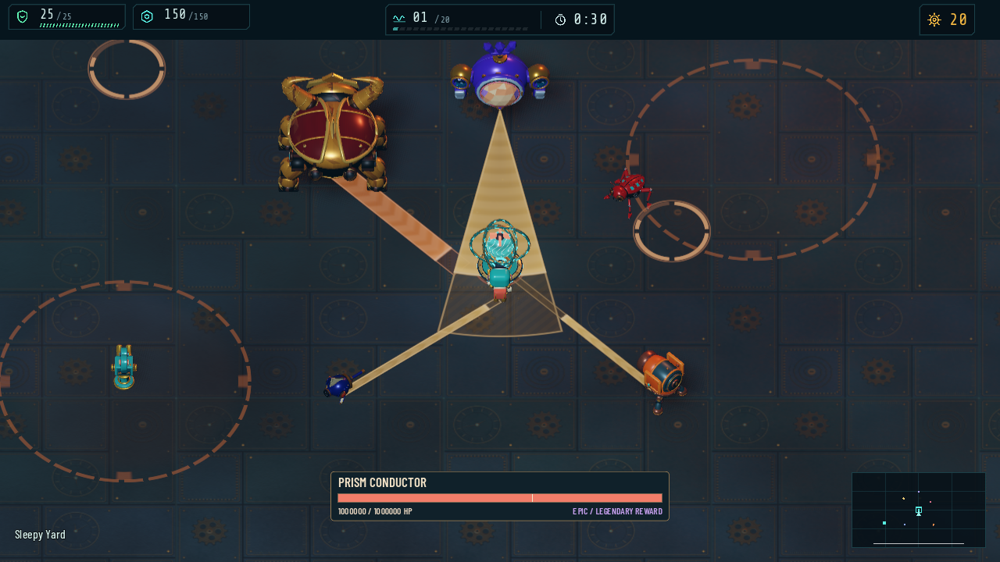

# Turret Survivor

A wave-based survival tower-defense game built in **Godot 4.7** with statically typed GDScript. You dodge a swarm of clockwork enemies while automated turrets do most of the killing, and you spend the scrap they earn between waves on new turrets, upgrades and evolutions.



## Features

- Native 3D arena with eight base turrets (Ion, Plasma, Shock, Tesla, Melee, Bow, Flamethrower, Bowling) and evolution branches unlocked at levels 5, 10 and 15
- A shop and item system between waves (50+ items), authored enemy waves, and boss fights with readable attack telegraphs
- Service-oriented architecture: autoload services, a signal bus (`Events`), data-driven registries, and explicit `reset_state()` for test isolation
- 800+ GUT tests plus headless progression smoke runs, executed in CI on every pull request

## Run it

Requirements: Godot **4.7.1** (pinned in `.godot-version`) and [Git LFS](https://git-lfs.com/) (the `.glb` models and `.blend` sources are stored in LFS, so a plain ZIP download will not work).

```powershell
git lfs install
git clone https://github.com/arebolledo2/turret-game.git
cd turret-game
$env:GODOT_BIN = "C:\path\to\Godot_v4.7.1-stable_win64.exe"
./launch.ps1
```

Or open the folder in the Godot editor and press F5. The launch and test scripts are PowerShell 7 (Windows); on other platforms, open the project in Godot directly.

## Tests

```powershell
./run_tests.ps1 -Import      # first run on a fresh checkout
./run_tests.ps1              # full GUT suite
```

See [doc/development.md](doc/development.md) for filters, smoke runs and conventions.

## Documentation

Start at [doc/index.md](doc/index.md): architecture, services, combat, entities, items, UI and the asset pipeline. Design plans and audits are in `doc/plans/`.

## How it was made

This is a solo project built with heavy AI assistance, and I would rather say so plainly:

- **Code and docs** were written in collaboration with Claude Code. The repo includes `AGENTS.md` and project skills under `.claude/skills/` describing that workflow.
- **2D concept art** was generated with my own orchestration tool, [image-gen-web](https://github.com/arebolledo2/image-gen-web), using image-generation models (and some ComfyUI and PixelLab for earlier sprites).
- **3D models** are built from that concept art with scripted Blender pipelines (`tools/blender/`) and exported to GLB.
- **Sound effects** are original and procedurally synthesized by `tools/build_game_audio.py`. Three older MP3 files in `assets/sounds/` are unused leftovers.
- **Fonts** are open-licensed (SIL OFL); license files are in `assets/fonts/`. The [GUT](https://github.com/bitwes/Gut) test addon is MIT-licensed.

## License

The code is released under the [MIT License](LICENSE). Generated art and models are included for demonstration; if you reuse them, check the terms of the image-generation services listed above.
