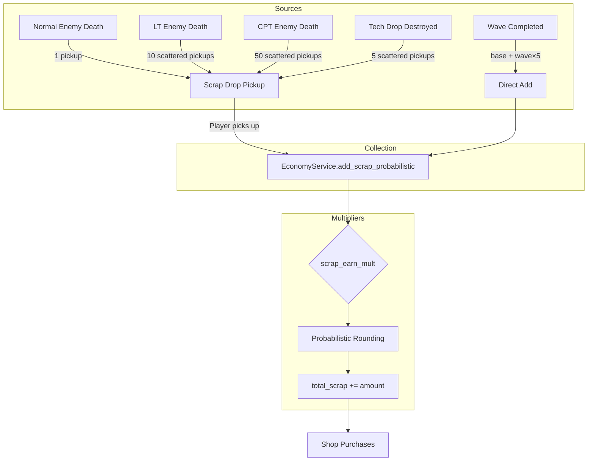

# Scrap System

Scrap is the unified in-game currency used for purchasing turrets and items in the shop between waves.

---

## Starting Scrap

| Constant | Value | Location |
|----------|-------|----------|
| `STARTING_SCRAP` | **20** | [game_constants.gd](file:///c:/Users/AndresRebolledo/source/repos/turret-dev/turret-game/scripts/data/game_constants.gd#L121) |

Players begin each run with **20 scrap**.

---

## Scrap Sources

### Enemy Drops

**All enemies drop pickups worth 1 scrap each.** The number of pickups depends on enemy rank:

| Enemy Rank | Pickups Dropped | Total Scrap | Scatter Radius |
|------------|-----------------|-------------|----------------|
| Normal | 1 | 1 | None (single drop) |
| Lieutenant | 10 | 10 | 60px |
| Captain | 50 | 50 | 100px |

When an enemy dies, it emits `scrap_dropped` signals. The [drop_spawner.gd](file:///c:/Users/AndresRebolledo/source/repos/turret-dev/turret-game/scripts/drop_spawner.gd) spawns physical [scrap_drop.gd](file:///c:/Users/AndresRebolledo/source/repos/turret-dev/turret-game/scripts/scrap_drop.gd) pickups at the death location (or scattered for elites).

Constants in [game_constants.gd](file:///c:/Users/AndresRebolledo/source/repos/turret-dev/turret-game/scripts/data/game_constants.gd):
- `ENEMY_RANK_LT_SCRAP_DROP_COUNT = 10`
- `ENEMY_RANK_CAPT_SCRAP_DROP_COUNT = 50`

### Wave Completion Bonus

Formula: `SCRAP_WAVE_BONUS_BASE + (wave × 5)`

| Constant | Value |
|----------|-------|
| `SCRAP_WAVE_BONUS_BASE` | 0 |

| Wave | Base Bonus |
|------|-----------|
| Wave 1 | 5 scrap |
| Wave 2 | 10 scrap |
| Wave 3 | 15 scrap |
| Wave 5 | 25 scrap |
| Wave 10 | 50 scrap |

Implemented in [wave_controller.gd:award_wave_bonus()](file:///c:/Users/AndresRebolledo/source/repos/turret-dev/turret-game/scripts/wave_controller.gd#L94-L101).

### Tech Drops

Destructible crates that spawn during waves. When destroyed by turrets:

| Constant | Value | Description |
|----------|-------|-------------|
| `TECH_DROP_SCRAP_REWARD` | **5** | Number of 1-scrap pickups scattered |
| `TECH_DROP_SCATTER_RADIUS` | 80px | Scatter radius |
| `TECH_DROP_SPAWN_INTERVAL` | 5.0s | Spawn attempt interval |
| `TECH_DROP_SPAWN_CHANCE` | 20% | Chance per interval |

Tech drops scatter **5 pickups** worth **1 scrap each** (5 total scrap).

---

## Scrap Scaling & Multipliers

### Scrap Earn Multiplier

Items can modify scrap earnings via the `scrap_earn_mult` modifier stat. The multiplier is applied when collecting scrap pickups.

```gdscript
# scrap_drop.gd:collect()
var scrap_mult = ItemTrackingService.get_scrap_earn_multiplier()
EconomyService.add_scrap_probabilistic(scrap_value, scrap_mult)
```

### Probabilistic Rounding

Fractional scrap amounts use probabilistic rounding in [economy_service.gd](file:///c:/Users/AndresRebolledo/source/repos/turret-dev/turret-game/scripts/autoload/economy_service.gd#L42-L52):

```gdscript
func add_scrap_probabilistic(base_amount: int, multiplier: float) -> int:
    var calculated: float = float(base_amount) * multiplier
    var actual_amount: int = floori(calculated)
    var chance: float = calculated - actual_amount
    if randf() < chance:
        actual_amount += 1
    total_scrap += actual_amount
    return actual_amount
```

Example: 1 scrap × 1.3 multiplier = 1.3 → 70% chance of 1, 30% chance of 2

### Wave Bonus Multiplier

The wave completion bonus can be scaled by items via `wave_bonus_mult`. Applied in [wave_controller.gd:award_wave_bonus()](file:///c:/Users/AndresRebolledo/source/repos/turret-dev/turret-game/scripts/wave_controller.gd#L99).

---

## Economy Flow Diagram



---

## Key Files

| File | Purpose |
|------|---------|
| [game_constants.gd](file:///c:/Users/AndresRebolledo/source/repos/turret-dev/turret-game/scripts/data/game_constants.gd) | All scrap-related constants |
| [economy_service.gd](file:///c:/Users/AndresRebolledo/source/repos/turret-dev/turret-game/scripts/autoload/economy_service.gd) | Scrap management, add/deduct functions |
| [enemy_registry.gd](file:///c:/Users/AndresRebolledo/source/repos/turret-dev/turret-game/scripts/registries/enemy_registry.gd) | Enemy scrap values (all set to 1) |
| [enemy.gd](file:///c:/Users/AndresRebolledo/source/repos/turret-dev/turret-game/scripts/enemy.gd) | `_spawn_scrap_drops()` handles rank-based scattering |
| [scrap_drop.gd](file:///c:/Users/AndresRebolledo/source/repos/turret-dev/turret-game/scripts/scrap_drop.gd) | Scrap pickup behavior |
| [drop_spawner.gd](file:///c:/Users/AndresRebolledo/source/repos/turret-dev/turret-game/scripts/drop_spawner.gd) | Spawns scrap drops on enemy death |
| [wave_controller.gd](file:///c:/Users/AndresRebolledo/source/repos/turret-dev/turret-game/scripts/wave_controller.gd) | Wave completion bonus |
| [tech_drop.gd](file:///c:/Users/AndresRebolledo/source/repos/turret-dev/turret-game/scripts/tech_drop.gd) | Tech drop scattering rewards |
| [item_tracking_service.gd](file:///c:/Users/AndresRebolledo/source/repos/turret-dev/turret-game/scripts/autoload/item_tracking_service.gd) | Scrap earn multiplier queries |
